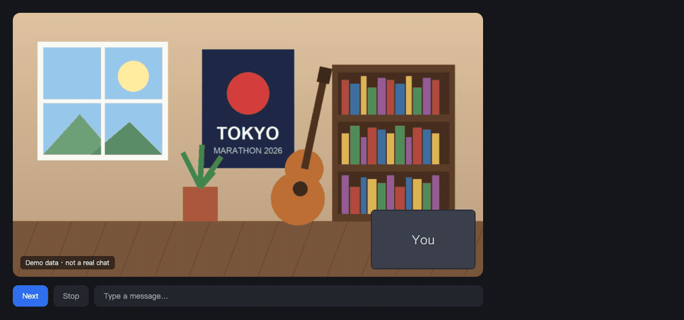
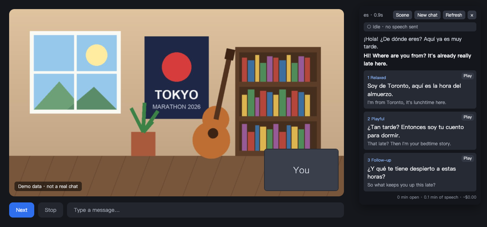
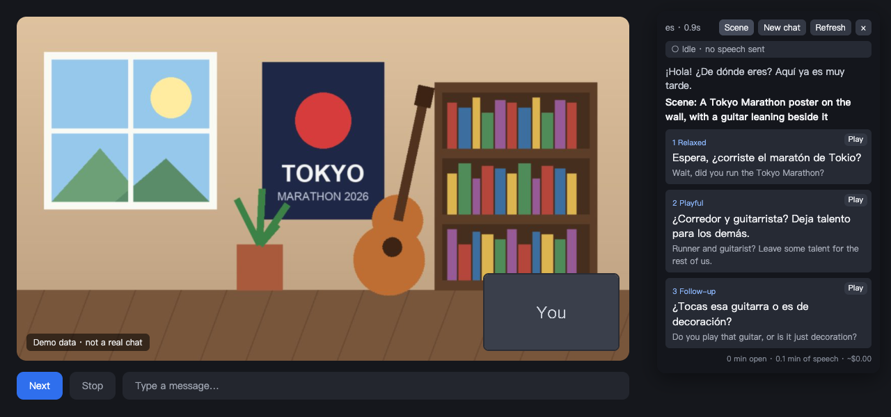
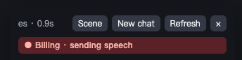

<div align="center">
  
  <h1>Banter</h1>
  <p><strong>Understand them. Keep the conversation going.</strong></p>
  <p>Live transcription, translation and reply suggestions for voice and video chats in Chrome.</p>
  <p>
    
    
    
    <a href="https://github.com/sailingGit/banter/actions/workflows/ci.yml"></a>
  </p>
  <p>
    <a href="#download">Download</a> ·
    <a href="#quick-start">Quick start</a> ·
    <a href="#features">Features</a> ·
    <a href="#cost">Cost</a> ·
    <a href="#data-and-privacy">Data and privacy</a> ·
    <a href="LICENSE">MIT License</a> ·
    <a href="README.md">中文</a>
  </p>
</div>

Banter is a Chrome extension that helps you keep talking in a foreign language on video and voice calls. It captures the other person's audio from the tab, transcribes it live, translates it into your own language, and suggests three replies in their language: relaxed, playful and a follow-up question. English lines come with IPA, and one click copies a reply or reads it aloud.

It works on any page with voice: random video chats, web meetings, voice rooms. It never acts on the page; it only shows a panel in the top-right corner. The interface is in English or Chinese, following the language you set.



> Everything in the demo is demo data. `npm run demo` drives the real extension against a mock page; it is not a real chat.

## Why

My OpenAI organization received developer platform credits, and I wanted to spend them on an idea of my own. I remembered chatting with strangers on OmeTV: people talk fast, you catch half of it, and you know what you want to say but not how to say it.

With a copilot beside you that translates live and hands you a few lines you can say right away, those chats turn into speaking practice. Banter is built for exactly that.

## Features

| Feature | What you get |
| --- | --- |
| Live transcription | OpenAI `gpt-live-transcribe` shows their words while they are still talking |
| Translation and IPA | Every line is translated into your language; English gets General American IPA |
| Reply suggestions | Three replies in their language, relaxed, playful and follow-up, each with a meaning in your language |
| Openers | Three icebreakers when you start and whenever you meet someone new |
| Scene topics | Out of ideas? Send one frame of the video and get topics from the objects and surroundings in it |
| Your language | Ten native languages, including English, Chinese, Japanese, Korean and Spanish; English or Chinese interface |
| About me | Replies only use what you wrote about yourself and never invent your experiences |
| Your level | Vocabulary and sentence length follow beginner, intermediate or advanced |
| Picking a reply | Click a card or press `1` `2` `3` to copy it; picked replies count as what you said |
| Read aloud | Hear the pronunciation before you say it |
| Billing indicator | The panel shows when speech is being sent, plus time and an estimated cost |
| Saving money | Silence is never sent; capture stops after 3 minutes without speech, and on reload or navigation |

<details>
<summary><strong>More screenshots: replies, scene topics and the Chinese interface</strong></summary>

### Reply suggestions



### Scene topics



### Chinese interface

For a Chinese speaker talking with someone in English:


</details>

## Download

Current version: **[v0.2.0](https://github.com/sailingGit/banter/releases/tag/v0.2.0)**.

| Component | Download | Status |
| --- | --- | --- |
| Chrome extension | [banter-0.2.0.zip](https://github.com/sailingGit/banter/releases/download/v0.2.0/banter-0.2.0.zip) | End-to-end tests pass; real API use still being tested |

Unzip it and follow "Load the extension" below. No Node.js needed. Banter is not on the Chrome Web Store yet.

## Quick start

### Requirements

- Chrome 116 or later.
- An OpenAI API key, used for live transcription and scene topics.
- Node.js 20 or later, only to build from source.

### 1. Get the extension

Download and unzip the release above, or build from source:

```bash
git clone https://github.com/sailingGit/banter.git
```

```bash
cd banter && npm install && npm run build
```

### 2. Load the extension

1. Open `chrome://extensions` and turn on Developer mode in the top-right corner.
2. Click "Load unpacked" and pick the unzipped folder, or `dist` if you built from source.

### 3. Settings

Right-click the extension icon and open Options:

| Setting | Notes |
| --- | --- |
| OpenAI API Key | Required, for live transcription and scene topics |
| My language | Translations and reply meanings use it, and so does the interface. Defaults to your browser language |
| Reply model | OpenAI `gpt-6-luna` by default, or any OpenAI-compatible endpoint |
| Endpoint URL / API Key / Model | For a compatible endpoint. The full `/chat/completions` URL works too; leave the key empty if none is needed |
| About me | A few facts about you. Replies only use what is here |
| Your level | Beginner, intermediate or advanced |
| Languages you expect | Optional, e.g. `es, fr`. Improves transcription; the first one is also used for openers |

For a compatible endpoint, Chrome asks for access to it when you save. If the endpoint lacks structured output, switch to `json_object` or prompt-only in Options; you can also set the reasoning effort. Replies should arrive within a second or two, so pick a fast model.

### 4. Start chatting

Open the page, then click the extension icon or press `Alt+Shift+C`. The icon shows `ON` and the panel appears. Do it again to stop.

## Usage

1. When the other person finishes a sentence, the panel shows what they said, a translation and three replies.
2. Click a card or press its number to copy a reply, then say it yourself.
3. Use Play on a card to hear it first. With speakers on, the other person may hear it too, so headphones help.
4. Out of things to say? Click Scene.
5. Click New chat when you meet someone new, so the last person's conversation stops shaping the suggestions.

| Action | Effect |
| --- | --- |
| `Alt+Shift+C` | Start or stop |
| `1` `2` `3` | Pick that reply; ignored while you type in a text field |
| Drag the panel header | Move the panel |

## Cost

Transcription is billed per minute (`gpt-live-transcribe` costs $0.017/minute) and is the main cost, about $1 an hour. Replies and scene topics use few tokens and cost next to nothing.



- A red "Billing" bar means speech is being sent to OpenAI; a grey "Idle" bar means nothing is being sent.
- Only audio with someone speaking is sent; silence stays on your machine.
- The panel footer shows how long capture has been on, how much speech was sent and an estimated cost. Replies from a compatible endpoint are not included in the estimate.

OpenAI's documentation does not say whether live transcription is billed by audio sent or by connection time, so "Idle" only means Banter is not sending speech. Your OpenAI bill is the source of truth.

## Scope of this version

This is **v0.2.0**, loaded in Developer mode and not yet on the Chrome Web Store.

- **Only their side**: Banter captures tab audio. Your own voice is not transcribed; the context only holds replies you picked.
- **Turn taking**: `gpt-live-transcribe` has no server-side turn detection, so Banter decides a sentence ended after about 0.6 seconds of silence, and cuts at 15 seconds of nonstop speech. Noisy rooms make this worse.
- **Language detection**: the language tag comes from the reply model, because transcription does not return one.
- **Interface language**: Chinese for a Chinese native language, English for every other one.
- **IPA**: English only.
- **Scene topics**: on sites that label their videos `#remote-video`, such as OmeTV, only the other person's video is used. Elsewhere the largest video on the page is used, which could be your own preview or a shared screen.
- **Transcription is OpenAI only**: a compatible endpoint only writes replies, and scene topics always use OpenAI.

## Data and privacy

- **Audio**: the other person's speech goes to OpenAI live, and the transcript goes to your reply model. Some places require consent before recording or transcribing someone; check your local rules.
- **Video frames**: Scene captures one frame only when you click it, scales it to 512 px and sends it to OpenAI. Nothing is stored and nothing is captured automatically. The model is told to describe surroundings and objects only, never to identify the person or comment on their looks, but that rests on the prompt alone.
- **Conversation**: transcripts and the conversation live in memory only and are cleared when you stop.
- **API keys**: keys are stored in plain text in this browser's `chrome.storage.local`. Do not share copies with your keys in them. The live transcription connection uses a short-lived secret, not your key.
- **Site terms**: some sites forbid third-party tools. Check first, or you risk a ban.

## Development

Plain JavaScript bundled with esbuild, with no runtime dependencies.

```bash
npm test
```

```bash
npx playwright install chromium && npm run test:e2e
```

```bash
npm run smoke
```

```bash
npm run demo
```

```bash
npm run package
```

```bash
npm run icons
```

- `npm test`: unit tests for turn detection, silence gating, the billing state, language resolution, request shapes and error messages.
- `npm run test:e2e`: loads the extension into real Chromium against local stand-ins for OpenAI and a compatible endpoint, covering capture, transcription, replies, scene topics, the options page, both interface languages and auto-stop. Set `CHROMIUM_PATH` to use an existing Chromium.
- `npm run smoke`: calls the real APIs for transcription, replies and image understanding, which costs a little. Keys come from `.env.local` and are never printed.
- `npm run demo`: drives the real extension on a demo page and re-records the Chinese and English GIFs and screenshots. Needs ffmpeg.
- `npm run package`: zips the built extension into `release/`.
- `npm run icons`: renders the extension icons from the SVGs in `assets/`. 16 and 32 px use a simplified drawing that stays sharp in the toolbar.

| Variable | Notes |
| --- | --- |
| `OPENAI_API_KEY` | Transcription, OpenAI replies and image understanding |
| `CHAT_BASE_URL` / `CHAT_API_KEY` / `CHAT_MODEL` | Optional, to test a compatible endpoint |
| `CHAT_FORMAT` | Optional: `json_schema`, `json_object` or `none` |

Local verification (2026-11-03): **30 unit tests and the end-to-end test pass**. The end-to-end test uses mocked APIs; the real APIs have not been run through `npm run smoke` yet.

[GitHub Actions](.github/workflows/ci.yml) runs the unit tests and uploads the packaged extension. See [Actions](https://github.com/sailingGit/banter/actions) for results.

| File | Role |
| --- | --- |
| `src/background.js` | Toggle, overlay injection, message relay |
| `src/offscreen.js` | Audio capture, wiring transcription to replies, conversation state, cost, auto-stop |
| `src/pcm-worklet.js` | Turns audio into 16-bit PCM chunks |
| `src/asr.js` | OpenAI live transcription, turn detection and silence gating |
| `src/suggest.js` | Prompts and reply model calls |
| `src/i18n.js` | Native languages and interface strings |
| `src/overlay.js` | The in-page panel |
| `src/options.html` | Options page |
| `test/e2e/harness.mjs` | Mock APIs and extension loading, shared by the e2e test and the demo |
| `assets/logo.svg` | The logo; `logo-small.svg` is the simplified 16 and 32 px version |
