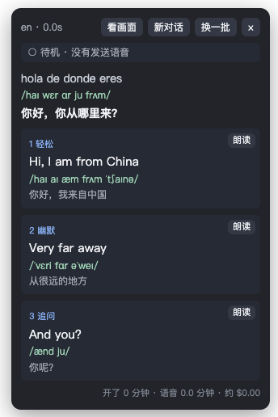
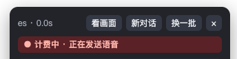

<div align="center">
  <h1>聊天副驾</h1>
  <p><strong>听懂对方，也接得上话。</strong></p>
  <p>Live transcription, translation and reply suggestions for voice and video chats in Chrome.</p>
  <p>
    <a href="#快速开始">快速开始</a> ·
    <a href="#功能">功能</a> ·
    <a href="#费用">费用</a> ·
    <a href="#数据与隐私">数据与隐私</a> ·
    <a href="LICENSE">MIT License</a>
  </p>
</div>

聊天副驾是一个 Chrome 扩展。它抓取标签页里对方的声音，实时转写并翻译成中文，再用对方的语言给出「轻松 / 幽默 / 追问」三条候选回复。英语会附上美式音标，点一下就能复制或朗读。

它能用在任何有语音的网页上：随机视频聊天、网页版会议、语音房都可以。扩展不会替你操作页面，只在页面右上角显示一个浮层。



> 截图来自端到端测试的模拟数据，不包含真实对话。

## 为什么做

OpenAI 给组织赠送了开发者平台的 credit，我想拿来做一点自己的创意。正好想起以前在 OmeTV 上和陌生人视频聊天的场景：对方说得快，听不全，想回又不知道怎么说。

如果有个副驾在旁边实时翻译，并给出几句能直接说出口的回复，这种聊天就能变成练口语的机会。聊天副驾就是为这个场景做的。

## 功能

| 能力 | 体验 |
| --- | --- |
| 实时转写 | 用 OpenAI `gpt-live-transcribe` 实时转写，对方还在说就能看到文字 |
| 翻译与音标 | 每句话翻译成中文；英语原文附美式音标 |
| 候选回复 | 三条回复用对方的语言写成，分轻松、幽默、追问三种，每条都有中文意思和音标 |
| 开场白 | 开始时和换人后，先给三句破冰的话 |
| 看画面 | 想不出话题时截一帧视频，根据画面里的物品和环境给出话题 |
| 关于我 | 回复只用你写下的个人信息，不替你编造经历 |
| 外语水平 | 按初级、中级、高级调整用词和句长 |
| 选用回复 | 点卡片或按 `1` `2` `3` 复制，选过的回复会作为你说的话，影响下一轮建议 |
| 朗读 | 开口前先听一遍发音 |
| 计费提示 | 浮层顶部显示语音是否正在发送，底部显示时长和预估费用 |
| 省钱 | 静音不发送；3 分钟没人说话、页面刷新或跳转时自动停止 |

## 快速开始

### 环境要求

- Chrome 116 或更高版本。
- Node.js 20 或更高版本，用来构建扩展。
- 一个 OpenAI API Key。实时转写和「看画面」都用它。

### 1. 克隆并构建

```bash
git clone https://github.com/sailingGit/live-chat-copilot.git
```

```bash
cd live-chat-copilot && npm install && npm run build
```

### 2. 加载扩展

1. 打开 `chrome://extensions`，开启右上角的「开发者模式」。
2. 点「加载已解压的扩展程序」，选择 `dist` 目录。

### 3. 填写设置

右键扩展图标，打开「选项」：

| 设置 | 说明 |
| --- | --- |
| OpenAI API Key | 必填。实时转写和「看画面」都用它 |
| 回复模型 | 默认用 OpenAI `gpt-6-luna`；也可以选任何兼容 OpenAI 格式的接口 |
| 接口地址 / API Key / 模型名 | 选兼容接口时填写。粘贴完整的 `/chat/completions` 地址也可以；接口不需要 Key 时可以留空 |
| 关于我 | 写一些你自己的情况，回复只会用这里的信息 |
| 外语水平 | 初级、中级或高级 |
| 常见语言 | 选填，比如 `en, es`。能提高转写准确度，第一个也是开场白的语言 |

选兼容接口时，保存时 Chrome 会询问是否允许访问这个地址。如果接口不支持结构化输出，选项页里可以改用 `json_object`，或者只靠提示词；也可以调整推理强度。回复要在一两秒内出来，建议选快的模型。

### 4. 开始聊天

打开要用的网页，点工具栏里的扩展图标，或按 `Alt+Shift+C`。图标上出现 `ON`，页面右上角出现浮层。再按一次即可停止。

## 使用方式

1. 对方说完一句，浮层显示原文、中文翻译和三条候选回复。
2. 点卡片或按数字键复制一句回复，再自己说出来。
3. 点卡片上的「朗读」可以先听发音。用外放时对方可能也会听到，建议戴耳机。
4. 想不出话题时点「看画面」。
5. 换了聊天对象就点「新对话」，否则上一位的内容会继续影响建议。

| 操作 | 作用 |
| --- | --- |
| `Alt+Shift+C` | 开始或停止 |
| `1` `2` `3` | 选用对应的回复；在输入框里打字时不触发 |
| 拖动浮层顶部 | 移动浮层 |

## 费用

转写按分钟计费（`gpt-live-transcribe` 为 $0.017/分钟），是主要开销，约 $1/小时。回复和「看画面」用的 token 很少，费用可以忽略。



- 浮层顶部是红色「计费中」时，语音正在发给 OpenAI；灰色「待机」表示没有发送。
- 只发送有人说话的音频，静音留在本地。
- 浮层底部显示开启时长、已发送的语音时长和预估费用。兼容接口的回复费用不计入预估。

OpenAI 的文档没有说明实时转写按发送的音频还是按连接时长计费，所以「待机」只代表扩展没有发送语音。实际费用以 OpenAI 后台账单为准。

## 当前版本范围

当前版本为 **v0.1.0**，以开发者模式加载，尚未发布到 Chrome 应用商店。

- **只听对方**：扩展只抓标签页的声音。你自己说的话不会被转写，上下文里只有你选用过的回复。
- **断句**：`gpt-live-transcribe` 没有服务端断句，扩展靠音量判断对方说完。静音约 0.6 秒算一句，连续说 15 秒会强制断开；环境很吵时断句会变差。
- **语种**：浮层上的语种由回复模型判断，因为转写不返回语种。
- **看画面**：在给视频标了 `#remote-video` 的网站上，比如 OmeTV，只取对方的画面。其他网站取页面上最大的视频，有可能是你自己的画面或共享的屏幕。
- **转写只支持 OpenAI**：兼容接口只用于生成回复，「看画面」也始终走 OpenAI。

## 数据与隐私

- **语音**：对方的语音实时发送给 OpenAI，转写文字发送给你选的回复模型。有些地区要求录音或转写前取得对方同意，请先确认当地规定。
- **画面**：「看画面」只在你点击时截取一帧，缩小到 512 像素后发给 OpenAI，不保存，也不会自动截图。模型被要求只看环境和物品，不识别身份，也不评价外貌，但这只靠提示词约束。
- **对话记录**：转写和对话只保存在内存里，停止后即清除，不写入磁盘。
- **API Key**：Key 以明文保存在本机的 `chrome.storage.local`，不要分发带 Key 的副本。实时转写连接使用临时密钥，不直接使用你的 Key。
- **网站条款**：有些网站禁止第三方工具，使用前请确认，否则有被封号的风险。

## 开发与验证

扩展用原生 JavaScript 编写，只有 `src/offscreen.js` 经 esbuild 打包，没有运行时依赖。

```bash
npm test
```

```bash
npx playwright install chromium && npm run test:e2e
```

```bash
npm run smoke
```

- `npm test`：断句、静音过滤、计费状态、请求格式和错误提示的单元测试。
- `npm run test:e2e`：把扩展加载进真实的 Chromium，用本地服务模拟 OpenAI 和兼容接口，覆盖抓音频、转写、回复、看画面、选项页和自动停止。也可以用 `CHROMIUM_PATH` 指定已有的 Chromium。
- `npm run smoke`：调用真实接口，会产生少量费用。Key 从 `.env.local` 读取，不会打印出来。

| 环境变量 | 说明 |
| --- | --- |
| `OPENAI_API_KEY` | 测试实时转写和 OpenAI 回复 |
| `CHAT_BASE_URL` / `CHAT_API_KEY` / `CHAT_MODEL` | 选填，测试兼容接口的回复 |
| `CHAT_FORMAT` | 选填，`json_schema`、`json_object` 或 `none` |

本地验收记录（2026-11-03）：**28 项单元测试和端到端测试通过**。端到端测试里的接口都是本地模拟的。

| 文件 | 作用 |
| --- | --- |
| `src/background.js` | 开关、注入浮层、转发消息 |
| `src/offscreen.js` | 抓音频，串起转写和回复，保存对话状态，统计费用，自动停止 |
| `src/pcm-worklet.js` | 把音频转成 16 位 PCM 分块 |
| `src/asr.js` | OpenAI 实时转写、断句和静音过滤 |
| `src/suggest.js` | 提示词和回复模型调用 |
| `src/overlay.js` | 页面浮层 |
| `src/options.html` | 设置页 |
